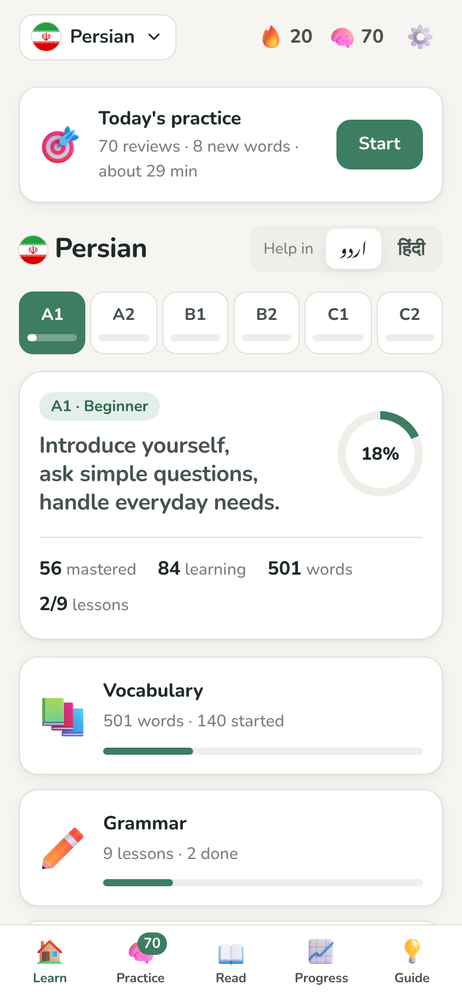
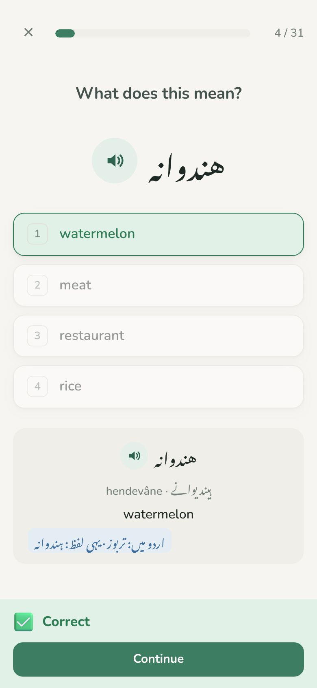
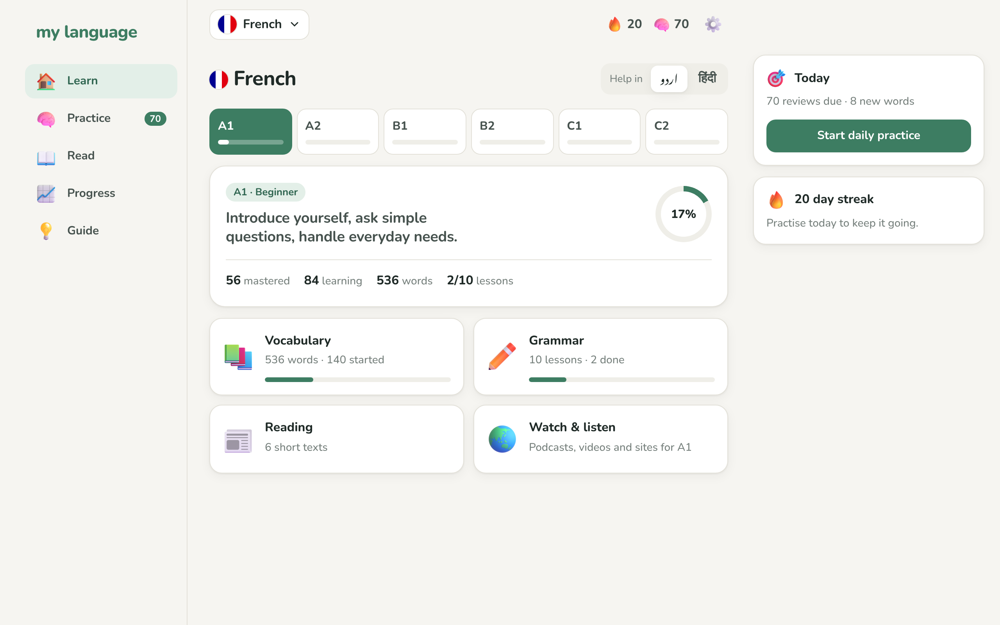

# My Language

A personal tutor for **French** and **Persian**, built for an Urdu and Hindi speaker. Every level from A1 to C2 is open from the start, with large word lists, grammar lessons, graded reading and spaced-repetition practice. Everything is in English; pronunciation and comparisons are shown in everyday Urdu or Hindi (your choice), so you lean on the thousands of words Persian shares with them. It runs on iPhone, Mac and the web from one codebase, works offline, and syncs your progress between devices.

**[Open the live app →](https://hamza-1224.github.io/my-language/)** and tap **Try the demo** to use it without an account. The demo keeps its progress in your browser and never touches the database.

<p>
  
  
  
  
</p>

## Features

- **Every level open.** Pick any level from A1 to C2. Each has four sections: Vocabulary, Grammar, Reading, and Watch & listen.
- **Large word lists.** About 500 words per level, grouped by topic: around 3,000 French words (A1 to C2) and 1,950 Persian words (A1 to B2, with a shorter core list for C1 and C2). Search, filter by topic, tick words and practise just those, or practise a whole topic.
- **Grammar you can repeat.** 43 French and 35 Persian lessons, each with an explanation, examples and questions. Many lessons also have drills built from the words you've learned (French verb conjugation, gender, être or avoir; Persian present and past tense, plurals, ezafe).
- **Calmer practice.** A start screen says what's coming; then new words, meaning questions both ways, flashcards for words you know well and grammar questions. Wrong answers come back later in the session, and the summary lists every word with ✓ or ✗ and a button to practise the missed ones. Keys 1–4, Enter and Esc work on a keyboard.
- **Spaced repetition.** Each word comes back just before you'd forget it (1, 3, 6, 15, 40… days).
- **Made for Urdu and Hindi speakers.** Pronunciation is written in Urdu or Hindi script, every Persian word shows its everyday Urdu or Hindi equivalent (and the shared word, when Urdu has it), and Persian grammar is compared with how you'd say it in Urdu or Hindi. The interface and explanations are in English.
- **Reading.** A1 and A2 have short texts written for the level, with audio and an English translation to reveal. B1 to C2 get six news articles per level every Monday, mixing culture, entertainment, sport, science, world news and society. Anything you mark as read is kept in "My reading".
- **Word bank.** See how many words you've learned, mastered, are still learning or aren't confident about, per level and as a list you can practise.
- **Persian audio.** Persian is spoken by a Microsoft neural voice (Dilara, Iranian Persian), recorded ahead of time, because iPhones and Macs have no Persian voice. French uses the device's voice.
- **Offline first.** Progress is saved on the device straight away and syncs when you're back online. If you study on two devices while offline, the two copies are merged word by word when they reconnect.
- **iPhone and Mac apps** that update themselves from the website.

## How it works

<p></p>

<p></p>

- **Static site, no server.** HTML, CSS and vanilla JavaScript: `app.js` (the tutor), `sync.js` (sign-in, sync, offline and updates) and the course content in `data/`.
- **Word lists.** The lists are plain text in `vocab/` (`# Topic` headers, then `word | english | …`). `scripts/build_vocab.py` turns them into `data/frvocab.js` and `data/favocab.js`, adding pronunciation in Urdu/Hindi script with espeak-ng.
- **Data model.** Progress is three JSON documents in one Postgres table, `docs (user_id, coll, id, data jsonb)`: `zb_state/settings`, `zb_state/fr` and `zb_state/fa`. The same table and account serve my [My Budget](https://github.com/hamza-1224/my-budget) and [Kanban](https://github.com/hamza-1224/my-kanban) apps; each app reads only its own documents.
- **Weekly reading without a server.** Browsers can't read the news sites' RSS feeds directly, so `.github/workflows/feeds.yml` runs `scripts/fetch_feeds.py` every Monday. It picks six articles per level (easier sources for B1, Le Monde for C1 and C2, DW, BBC and RFI Persian for Persian), one per topic where it can, and publishes `fr.json` and `fa.json` to the `feeds` branch, which the app reads.
- **Persian audio.** `.github/workflows/audio.yml` runs when Persian content changes: `scripts/audio_texts.js` lists every Persian word, example and reading text, and `scripts/make_audio.py` records the new ones with [edge-tts](https://github.com/rany2/edge-tts) into `audio/fa/`, named by a hash of the text. The app hashes the text the same way to find the file.
- **Updates.** `version.json` is compared with the running version; open copies show "Update ready". The iPhone and Mac apps download the new page and keep it for the next launch, falling back to their built-in copy if it fails to start.

## Privacy and security

- **No data in this repository.** Progress lives in Supabase, protected by row-level security: the policies in [`schema.sql`](schema.sql) only let a signed-in user read or change their own rows.
- **No secrets in the code.** `config.js` holds only the Supabase URL and the *publishable* key, which is designed to be public. Sign-ups are disabled, so the app is single-user.
- **No AI or analytics** in the hosted app. (The original laptop version had optional AI feedback through a local server; it isn't part of this version.)

## Tech stack

| Part | Technology |
| --- | --- |
| App | HTML, CSS, vanilla JavaScript, Web Speech API (French) |
| Look | Nunito and Noto Nastaliq Urdu fonts, [Fluent Emoji](https://github.com/microsoft/fluentui-emoji) illustrations, [flag-icons](https://github.com/lipis/flag-icons) flags |
| Data and auth | Supabase (Postgres, row-level security, Realtime, email/password auth) via supabase-js |
| Hosting | GitHub Pages, service worker for offline use |
| Reading | GitHub Actions on a schedule, Python standard library |
| Persian voice | Microsoft neural voice fa-IR-DilaraNeural via edge-tts, recorded in GitHub Actions |
| Pronunciation | espeak-ng (via phonemizer), converted to Urdu and Hindi script |
| iPhone app | Capacitor 8 (Swift Package Manager) |
| Mac app | Tauri 2 (Rust), universal binary for Apple Silicon and Intel |

## Project layout

```
index.html              page shell
app.js                  the tutor: levels, vocabulary, grammar, practice, reading, progress
sync.js                 sign-in, sync with Supabase, demo, offline cache, updates
style.css               styles (light and dark)
data/                   course content: grammar, word lists, drills, reading texts and resources
vocab/                  word lists as editable text, one file per language and level
audio/fa/               recorded Persian audio (made by GitHub Actions)
sw.js                   offline support (service worker)
version.json            current version, used for update checks
config.js               Supabase URL and publishable key
schema.sql              database table, security policies and realtime setup
scripts/                weekly reading, Persian audio and word-list build scripts
fonts/                  Nunito and Noto Nastaliq Urdu (SIL Open Font License)
img/                    illustrations (Fluent Emoji, MIT) and flags (flag-icons, MIT)
native/                 iPhone app (Capacitor) and the shared loader
desktop/                Mac app (Tauri)
docs/                   screenshots and diagrams (demo data)
```

## Run your own copy

1. Fork this repository and enable GitHub Pages (Settings → Pages → deploy from `main`, root folder).
2. Create a free [Supabase](https://supabase.com) project, run [`schema.sql`](schema.sql) in its SQL Editor, create your user and turn off "Allow new users to sign up".
3. Put your project URL and publishable key in `config.js`, and your own addresses in `REMOTE` and `FEEDS` at the top of `sync.js`.
4. Run the "Weekly reading list" and "Persian audio" workflows once from the Actions tab.

To release a change, bump the version in `version.json`, `APP_VERSION` in `sync.js` and the cache name in `sw.js` together.

<p></p>

## Author

Built by [@hamza-1224](https://github.com/hamza-1224).
