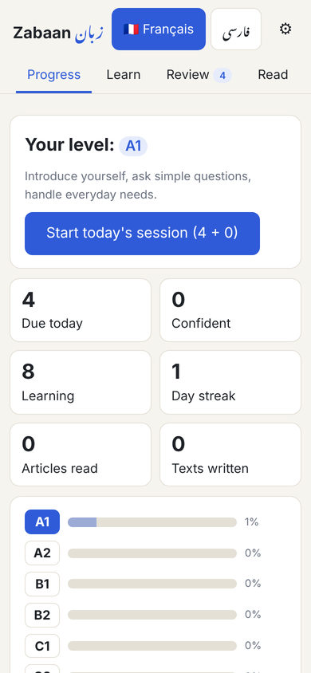
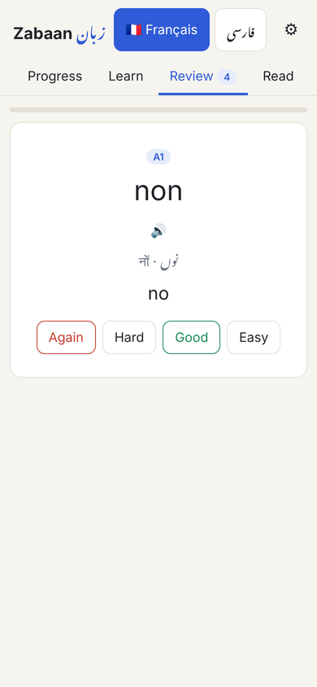
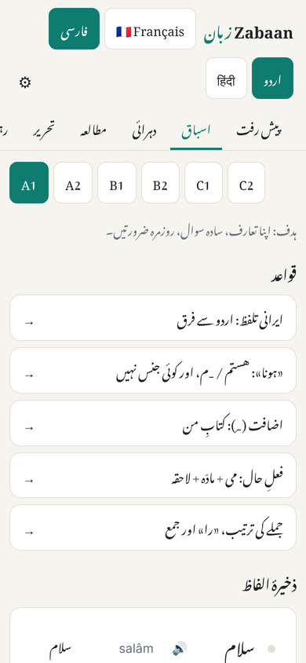
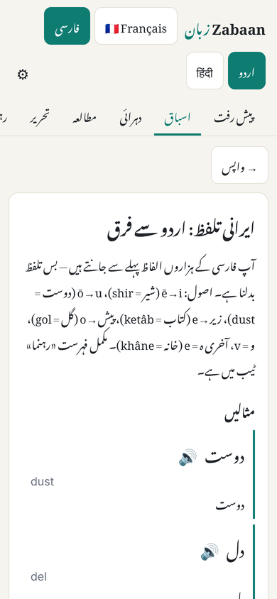
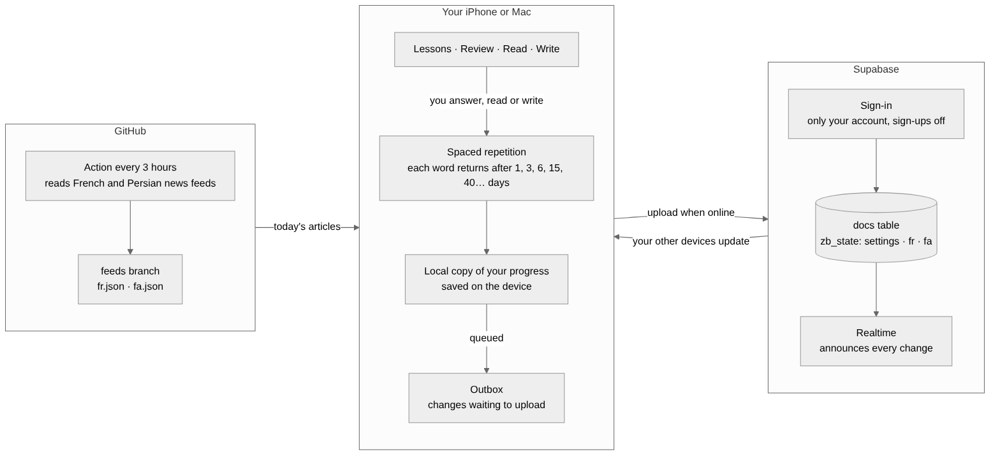
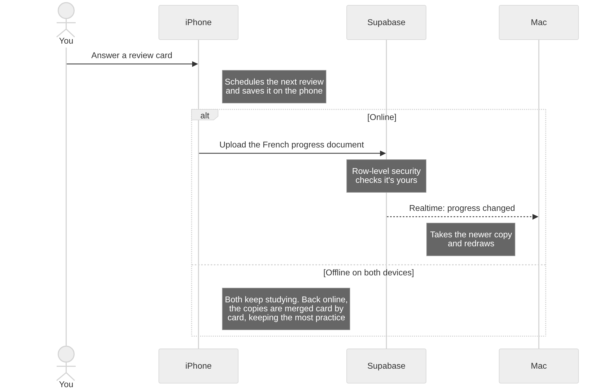

# Zabaan · زبان

A personal tutor for **French** and **Persian**, built for an Urdu and Hindi speaker. Persian lessons are explained in Urdu (or Hindi) and lean on the thousands of words the two languages share. It runs on iPhone, Mac and the web from one codebase, works offline, and syncs your progress between devices.

**[Open the live app →](https://hamza-1224.github.io/my-language/)** and tap **Try the demo** to use it without an account. The demo keeps its progress in your browser and never touches the database.

<p>
  
  
  
  
</p>

## Features

- **Two courses, A1 to C2.** French and Persian vocabulary and grammar lessons for each CEFR level, with goals for each level.
- **Spaced repetition.** Each word comes back just before you'd forget it (1, 3, 6, 15, 40… days), with Again / Hard / Good / Easy grading and a few new words a day.
- **Made for Urdu and Hindi speakers.** Pronunciation is written in Devanagari or Nastaliq, Persian lessons are explained in Urdu or Hindi, and Persian cognates are pointed out.
- **Read real news.** The Read tab shows the day's articles from French and Persian news sites, refreshed every three hours.
- **Write.** A journal for practising, saved with your progress.
- **Listen.** Every word can be spoken by your device's French or Persian voice.
- **Offline first.** Progress is saved on the device straight away and syncs when you're back online. If you study on two devices while offline, the two copies are merged word by word when they reconnect.
- **iPhone and Mac apps** that update themselves from the website.

## How it works

<p></p>

<p></p>

- **Static site, no server.** HTML, CSS and vanilla JavaScript: `app.js` (the tutor), `sync.js` (sign-in, sync, offline and updates) and the course content in `data/`.
- **Data model.** Progress is three JSON documents in one Postgres table, `docs (user_id, coll, id, data jsonb)`: `zb_state/settings`, `zb_state/fr` and `zb_state/fa`. The same table and account serve my [My Budget](https://github.com/hamza-1224/my-budget) and [Kanban](https://github.com/hamza-1224/my-kanban) apps; each app reads only its own documents.
- **News without a server.** Browsers can't read the news sites' RSS feeds directly, so `.github/workflows/feeds.yml` runs `scripts/fetch_feeds.py` every three hours and publishes `fr.json` and `fa.json` to the `feeds` branch, which the app reads.
- **Updates.** `version.json` is compared with the running version; open copies show "Update ready". The iPhone and Mac apps download the new page and keep it for the next launch, falling back to their built-in copy if it fails to start.

## Privacy and security

- **No data in this repository.** Progress lives in Supabase, protected by row-level security: the policies in [`schema.sql`](schema.sql) only let a signed-in user read or change their own rows.
- **No secrets in the code.** `config.js` holds only the Supabase URL and the *publishable* key, which is designed to be public. Sign-ups are disabled, so the app is single-user.
- **No AI or analytics** in the hosted app. (The original laptop version had optional AI feedback through a local server; it isn't part of this version.)

## Tech stack

| Part | Technology |
| --- | --- |
| App | HTML, CSS, vanilla JavaScript, Web Speech API, Noto Nastaliq Urdu font |
| Data and auth | Supabase (Postgres, row-level security, Realtime, email/password auth) via supabase-js |
| Hosting | GitHub Pages, service worker for offline use |
| News | GitHub Actions on a schedule, Python standard library |
| iPhone app | Capacitor 8 (Swift Package Manager) |
| Mac app | Tauri 2 (Rust), universal binary for Apple Silicon and Intel |

## Project layout

```
index.html              page shell
app.js                  the tutor: lessons, spaced repetition, reading, writing
sync.js                 sign-in, sync with Supabase, demo, offline cache, updates
style.css               styles (light and dark)
data/                   French and Persian course content
sw.js                   offline support (service worker)
version.json            current version, used for update checks
config.js               Supabase URL and publishable key
schema.sql              database table, security policies and realtime setup
scripts/fetch_feeds.py  news feed fetcher run by GitHub Actions
fonts/                  Noto Nastaliq Urdu (SIL Open Font License)
native/                 iPhone app (Capacitor) and the shared loader
desktop/                Mac app (Tauri)
docs/                   screenshots and diagrams (demo data)
```

## Run your own copy

1. Fork this repository and enable GitHub Pages (Settings → Pages → deploy from `main`, root folder).
2. Create a free [Supabase](https://supabase.com) project, run [`schema.sql`](schema.sql) in its SQL Editor, create your user and turn off "Allow new users to sign up".
3. Put your project URL and publishable key in `config.js`, and your own addresses in `REMOTE` and `FEEDS` at the top of `sync.js`.
4. Run the "Refresh news feeds" workflow once from the Actions tab.

To release a change, bump the version in `version.json`, `APP_VERSION` in `sync.js` and the cache name in `sw.js` together.

<p></p>

## Author

Built by [@hamza-1224](https://github.com/hamza-1224).
