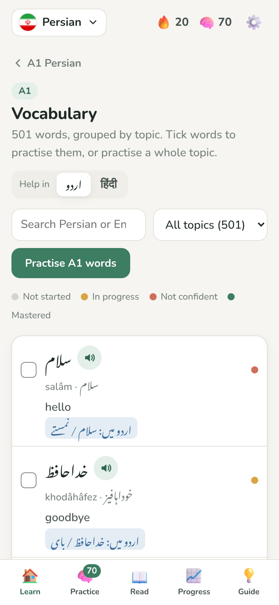
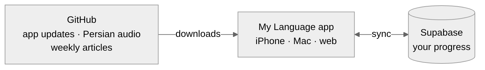

# My Language

A personal French and Persian tutor for Urdu and Hindi speakers. Runs on iPhone, Mac and the web.

**[Open the app →](https://hamza-1224.github.io/my-language/)** (tap **Try the demo**, no account needed)

  
  
  
  

## Features

- All levels A1–C2 open, each with vocabulary, grammar, reading and resources
- About 500 words per level, grouped by topic
- Grammar lessons with practice you can repeat
- Spaced-repetition practice
- Short texts for A1–A2; six new articles per level every week for B1–C2
- Word bank: learned, mastered, in progress, not confident
- Pronunciation and comparisons in Urdu or Hindi
- Persian audio from a Microsoft neural voice
- Works offline and syncs between devices

## How it works

## Tech stack

| Part | Technology |
| --- | --- |
| App | HTML, CSS, JavaScript |
| Data | Supabase |
| Hosting | GitHub Pages |
| Articles and audio | GitHub Actions |
| iPhone / Mac | Capacitor / Tauri |

Built by [@hamza-1224](https://github.com/hamza-1224).
